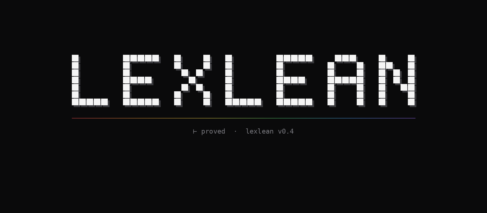

<div align="center">
  

  <p><strong>One controlled language in. A canonical paper, a kernel checked Lean 4 program, and a certified Rust package out.</strong></p>
</div>

# LexLean

[Spec](SPEC.md) · [Conformance](CONFORMANCE.md) · [Diagnostics](ERRORS.md) · [Evidence](VERIFICATION.md) · [Changelog](CHANGELOG.md) · [MNIST model](https://github.com/UOR-Foundation/MNIST)

A closed-lexicon LaTeX-to-Lean 4 compiler whose canonical document and prose-free Lean program are generated from one semantic representation.

The complete normative contract is [SPEC.md](SPEC.md) (`LEXLEAN-SPEC-1`). Every capability below is a claim in [`model/ids.toml`](model/ids.toml), carried at honesty level `build`: constructed here and validated against its oracle by the test named `conformance_<id>`. The generated register is [CONFORMANCE.md](CONFORMANCE.md); the closed diagnostic registry is [ERRORS.md](ERRORS.md); the falsifiability evidence is in [VERIFICATION.md](VERIFICATION.md).

## What it does

LexLean compiles `.lex.tex` modules written in a closed controlled language: every word, symbol, and control must be declared by a versioned lexicon package, every sentence parses under a fixed grammar, and one typed intermediate representation generates both the canonical LaTeX document and the prose-free Lean 4 program. Verification compiles the generated Lean under the pinned `leanprover/lean4:v4.32.2` toolchain, replays every module with `leanchecker`, audits axioms with exact `#print axioms` parsing, and publishes a content-addressed attestation.

```text
lexlean init --name my-doc --module-prefix MyDoc
lexlean lock
lexlean check
lexlean build
lexlean verify
```

## Install

`lexlean verify` runs the pinned `leanprover/lean4:v4.32.2` toolchain, so the
published container image carries both and is the shortest path to a run that
can actually verify:

```text
docker pull ghcr.io/<owner>/lexlean:<version>
docker run --rm -v "$PWD:/work" ghcr.io/<owner>/lexlean:<version> verify
```

`release.yml` publishes the image for a tagged release under the repository's
owner, with the tag's version as the image tag. The only tag so far is
`v0.1.0`, whose image is `ghcr.io/afflom/lexlean:0.1.0`.

The image is around 4 GB, nearly all of it the pinned toolchain's compiled
library — the part `verify` needs and the part a smaller image would have to
leave out.

Each [release](https://github.com/UOR-Foundation/LexLean/releases) also attaches one
binary per supported host (SPEC.md §8.3), the packaged crate, a CycloneDX bill
of materials, `checksums.txt` over every other asset, and the `just vv`
evidence for the tagged commit. A binary alone can `init`, `lock`, `fmt`,
`check`, and `build`; `verify` additionally needs the pinned toolchain
installed through [elan](https://github.com/leanprover/elan).

From source, with the prerequisites below:

```text
cargo install --locked --path crates/lexlean
```

Versions follow SPEC.md §30.1 and are recorded in [CHANGELOG.md](CHANGELOG.md).
§2.3 fixes `0.1.0` as the initial implementation version and `1.0.0` as the
first release satisfying the complete specification, so a `0.1.0` tag does not
claim the §30 release criterion — `cargo xtask release-check` reads that
criterion and says exactly which parts of it do not hold.

## The literal example

[examples/nat-add-zero/src/Main.lex.tex](examples/nat-add-zero/src/Main.lex.tex) is the complete SPEC.md §29 document:

```latex
\begin{lexlean}{Main}
\useglossary{lexlean.std.nat@1.0.0}
\title{Natural number addition}

\begin{theorem}{add-zero}
\noaxioms
For every natural number \(n\), \(n + 0 = n\).
\begin{proof}
Close the goal by reflexivity.
\end{proof}
\end{theorem}
\end{lexlean}
```

From one linked representation it generates the prose-free Lean module

```lean
module
public import Init
set_option autoImplicit false
namespace LexLeanExample.Main

public theorem add_zero (llv0 : Nat) : Eq (Nat.add llv0 0) llv0 := by
  rfl

end LexLeanExample.Main
```

and the canonical LaTeX document, regenerated from IR rather than copied ("The goal follows by reflexivity."), plus source maps, coverage, and a manifest — all byte-reproducible across directories. `lexlean verify` then compiles the module under the pinned toolchain, replays it with `leanchecker`, parses `#print axioms` exactly, and records the empty observed axiom set in a content-addressed attestation.

## How it works

```text
just vv        # the complete normative acceptance gate (SPEC.md §9.2)
just release   # vv, then the §30 release criterion; refused until 1.0.0
```

`lexlean init` scaffolds a project and claims nothing. `lock` pins lexicons and dependencies. `check` checks closure, grammar, typing, and diagnostics, never verification. `build` generates Lean, LaTeX, source maps, and manifests, never verification. `verify` compiles under the pinned toolchain, replays with `leanchecker`, audits axioms, and attests; it is the only verified claim. `production build` exports certified Rust packages. `migrate --to 1.2` upgrades a language 1.1 project in a scratch copy first and writes nothing on refusal.

The differential against the independent generator `lean4-prod` (SPEC.md §17.19, `OR-01`..`OR-08`) acquires it at its pinned commit: from the checkout `LEXLEAN_ORACLE_DIR` names, or by fetching the commit with `git` into the Cargo target directory (`LEXLEAN_ORACLE_CACHE` overrides), and builds it with the pinned Lean and Rust toolchains. It is validation evidence only and no input to any identity. An oracle that cannot be acquired, is not the pinned files, or fails is unavailable: that fails the gate on Linux x86-64 and is printed as `NOT VALIDATED` elsewhere, and is never reported as agreement.

`just vv` is the Linux x86-64 gate. On the other four supported hosts (§8.3) the crate builds and every test runs. A case whose assertions need something the host does not have runs its platform-independent assertions and prints which ones it skipped: the pinned toolchain, a `#!/bin/sh` program for the external-provider cases, a filesystem that distinguishes two names differing only in case, or one that accepts a name that is not valid UTF-8. Each is detected at run time rather than assumed from the target triple, and on Linux x86-64 the toolchain gate is mandatory, so nothing there passes vacuously.

Releases live on release lines (SPEC.md §9.4): `release/vX.Y` is the branch of the release X.Y, cut from `main` when its work begins and the target of its pull requests; tags are made from it, it is merged forward into the next line after each landing, and `main` is the newest released line. A push to a release line runs the same gate as a push to `main`.

## Capabilities

| Capability | IDs | Level |
| --- | --- | --- |
| Exact repository identity, layout, generated documents, release gate reading its criterion from the specification, total classification of every closed enum by every consumer, the devcontainer pinned to the toolchains, a check-only build without the production data, and the browser prover's runtime `.olean` files, driver, and WASI executable, labelled by BLAKE3 κ, on every release | `RP-01`..`RP-20` | `build` |
| Closed project configuration, canonical lock file, and offline dependency policy | `CF-01`..`CF-18` | `build` |
| Total lexical closure: every accepted atom is covered by exactly one declared origin | `LX-01`..`LX-14` | `build` |
| Versioned lexicon packages with closed schemas, denotations, and renderer tokens | `GL-01`..`GL-18` | `build` |
| Fixed structural, mathematical, and proposition grammar with closed ambiguity handling | `GR-01`..`GR-16` | `build` |
| Typed closed IR with canonical serialization, native core modules (and the second schema of them that lossless migration of the proof library needs), portable language-1.1 application data and operations, versioned language-1.2 semantic modules, products, first-class functions, and widening conversions, ordered collections and graphs, semantic snapshots, alpha identities, recursion evidence, a split on a document term or a Boolean in a proof, bitwise and shift primitives over `Nat`, content identities, and declaration and statement IDs | `SM-01`, `SM-02`, `SM-03`, `SM-04`, `SM-05`, `SM-06`, `SM-07`, `SM-08`, `SM-09`, `SM-10`, `SM-11`, `SM-12`, `SM-13`, `SM-14`, `SM-15`, `SM-16`, `SM-17`, `SM-18`, `SM-19`, `SM-20`, `SM-21`, `SM-22`, `SM-23`, `SM-24`, `SM-25`, `SM-26`, `SM-27`, `SM-28`, `SM-29`, `SM-30`, `SM-31`, `SM-32`, `SM-33`, `SM-34`, `SM-35`, `SM-36`, `SM-37`, `SM-38`, `SM-42`, `SM-44` | `build` |
| Document and generic semantic declarations with exact self-application, type checking, structural recursion, recursive and mutual language-1.2 data, generic and executable higher-order definitions, mutual and well-founded recursion with semantic evidence, explicit state threading, and acyclicity rules | `DF-01`..`DF-19` | `build` |
| The structured proof language with pinned Lean lowerings, including closed linear arithmetic, integer order, the fold laws, the runtime bounds, decision regions, long first-match chains, and natural-number arithmetic laws | `PF-01`, `PF-02`, `PF-03`, `PF-04`, `PF-05`, `PF-06`, `PF-07`, `PF-08`, `PF-09`, `PF-10`, `PF-11`, `PF-12`, `PF-13`, `PF-14`, `PF-15`, `PF-16`, `PF-17`, `PF-18`, `PF-19`, `PF-20`, `PF-21`, `PF-22`, `PF-23`, `PF-24`, `PF-26`, `PF-27`, `PF-28` | `build` |
| Prose-free deterministic generated Lean with complete token traceability | `LN-01`..`LN-12` | `build` |
| Canonical LaTeX regeneration and the optional hash-checked PDF provider | `TX-01`..`TX-12` | `build` |
| Canonical diagnostics, source maps, coverage, manifests, and reproducible builds | `AR-01`..`AR-16` | `build` |
| Sixteen-stage verification with leanchecker replay and exact axiom audit | `VR-01`..`VR-23` | `build` |
| The exact CLI contract, the stable seven-method Rust `Engine` API, the host-driven end of the children the library started, the `production` subcommands, the `migrate` command, and `check` on `wasm32-wasip1` | `CL-01`..`CL-28` | `build` |
| Filesystem confinement, no shell, no hidden network, closed failure model | `SE-01`..`SE-12` | `build` |
| Language-1.2 production eligibility: closed targets, effects, and construct dispositions; runtime closures; target-dependent, fail-closed root analysis; deterministic eligibility reports; an exhaustiveness audit; measured stack bounds for every recursive root a harness runs; the effect each host request realizes | `PD-01`, `PD-02`, `PD-03`, `PD-04`, `PD-05`, `PD-06`, `PD-07`, `PD-08`, `PD-10` | `build` |
| Named-root extraction through Lean's compiler front end: an adapter that is a closed tooling module over a registry derived from the pinned Lean and probed on every extraction, checked against a handwritten oracle; a closed, canonical, root-independent compiler input; fail-closed rejection; and an exact closure cross-check against production eligibility | `NE-01`..`NE-06` | `build` |
| The production realization calculus: a closed target syntax with canonical identity, a kernel-checked denotation, a realization library agreeing with LexLean's own collection primitives, complete realization coverage of the production registry, and a differentially tested Rust profile | `TC-01`..`TC-07` | `build` |
| The canonical Rust backend: a closed, checked Rust AST whose every construct corresponds to the calculus; hygienic identifiers, single ownership with last-use and component moves, exact failure typing, and no hidden allocation; contiguous lists with constant-work cells; a closed runtime library boundary of stated machine primitives; deterministic packages with checked exports, a lint gate and crate attributes read from one embedded language module, and provenance that states the realization's effects | `RB-01`, `RB-02`, `RB-03`, `RB-04`, `RB-05`, `RB-06`, `RB-07`, `RB-08`, `RB-09`, `RB-10`, `RB-11`, `RB-12`, `RB-13`, `RB-14`, `RB-15`, `RB-16`, `RB-17`, `RB-19`, `RB-20`, `RB-21`, `RB-22`, `RB-24` | `build` |
| GNAF requests over the calculus: an optimizer-independent complete-system universe, a machine contract that accounts every action, scalar and Pareto orders without weighting, fail-closed validation, kernel-checked answers and authority vectors, and the machine contracts of the production targets (exact instruction semantics and a step-vector cost for AVX2, NEON and SIMD128, held to the instruction by a differential) | `GN-01`..`GN-09` | `build` |
| GNAF certification: certificates that prove a global optimum, an argmin, or a complete Pareto frontier over the request's declared universe (a grammar of systems, never all calculus or Rust programs) from a premise for every system, a library proving the checker sound, closed transformation schemas, local normality kept distinct from optimality, a bridge from a representation metric to execution cost, and honest non-global statuses | `GC-01`..`GC-11` | `build` |
| Semantic preservation from the source to the calculus: a validated lowering of every production root, a kernel-checked certificate per root relating the lowered program to the source denotation with exact width predicates, a differential evaluator, a proof library that is LexLean source (native core modules migrated once from the Lean it replaces, its Lean generated by the compiler) pinned by exact axioms, certificate checking in verification, a declared Rust machine on which every rendering is evaluated, certificate B relating every rendering to its program, certificate E composing them end to end on the declared Rust machine (the printer, export wrappers, and `rustc` are outside it and are measured by the rustc differential), boundary validators, a rustc differential of the declared machine, and certificates A and B as kernel-term data built by the production compiler, which carries no Lean text template | `SP-01`, `SP-02`, `SP-03`, `SP-04`, `SP-05`, `SP-06`, `SP-07`, `SP-08`, `SP-09`, `SP-10`, `SP-11`, `SP-12`, `SP-13`, `SP-14`, `SP-15`, `SP-16`, `SP-17`, `SP-18`, `SP-19`, `SP-20`, `SP-21`, `SP-22`, `SP-23`, `SP-25`, `SP-26`, `SP-27`, `SP-28`, `SP-29`, `SP-30`, `SP-32`, `SP-33`, `SP-34` | `build` |
| Language-1.2 models: content-addressed typed artifacts, contracts with sound validators, exact deterministic, rule, statistical, neural (integer kernels), and composite realizations, generated evidence obligations restated in Lean, checked runtime boundaries, and their identity, production, and verification | `MD-01`..`MD-13` | `build` |
| The differential validation oracle: `lean4-prod` pinned by commit and content hash as validation evidence only, a corpus of every production root and one probe per runtime construct, a comparison of acceptance, contract, behavior, and resources that never compares bytes, versioned tables of known differences and of constructs outside the overlap, planted discrepancies detected, failures that are unavailable rather than validated, and its isolation from every identity | `OR-01`..`OR-08` | `build` |
| The production export contract: a stable, versioned `lexlean::api::production` façade and its CLI through which a consumer compiles production roots to certified Rust packages; closed requests refused before Lean on every root, target, pin, evidence, path, and package defect; results binding every output to the source, semantic, compiler-semantics, target, compiler-input, preservation, and certificate identities with unforgeable certification; deterministic, confined, offline bundles; source-free replay; versioned schemas; each output's effects and what `recursion` asks of the host | `PX-01`..`PX-13` | `build` |
| Language-1.2 reasoning machines: logics, guarded inference rules, verifiers, and forward, search, and generate-and-verify reasoners elaborated to ordinary declarations, with exact obligations, fixed-template theorems over the axiom-free reasoning runtime, a closed runtime boundary, resource ledgers, and their production and calculus realization, with GNAF requests over the clinical rule base's forward-chaining plans | `RS-01`..`RS-14` | `build` |
| Language-1.2 compiler-tooling modules: a closed, typed program over a registry of the external Lean interface (types with exact constructors and index requirements, calls with exact signatures), with flat index-exhaustive matching, licensed partial and mutual recursion, complete recursive traversal, command registration, invocation and evaluation as semantic data, both backends from one linked value, and no member that holds Lean text | `TL-01`..`TL-11` | `build` |
| The language-1.2 authoring notation: a readable `.lex.tex` text for a semantic module, in bijection with its canonical JSON, whose every position and variant is read from the schema, with readable forms for types and terms and a generic form for every other value, formatted canonically by `fmt` failing closed, the only form in which a language-1.2 source of the product is written (the data form is refused under language 1.2, and `lexlean::sdk` is the explicit conversion), the same for the compiler-tooling modules in the generic notation, with no compiler-semantics ID that depends on which form an embedded module is written in, with no product source owned by a generator but five named records, read and written by programs only through the authoring API (`lexlean::sdk`), and, for a native core module, a readable program over the shared table of kernel terms whose numbering is the order of its text | `AU-01`..`AU-14` | `build` |
| The runtime of generated Lean as native modules: the portable, collection, model, and reasoning runtimes of language 1.2 are LexLean source that every generated module imports, migrated losslessly and audited against their exact axioms, the released runtime text of languages 1.0 and 1.1 is frozen data equal to their released output, and no other Lean runtime text remains in the compiler but the decoder of core module 2 | `RT-01`..`RT-04` | `build` |
| The standard library: language-1.2 source beside the compiler whose members are certified production roots, each validated against its oracle by a seeded differential of its evaluator and rustc realizations; bytes and text over `Bytes`, an output buffer of a given capacity written in order; decimal and hexadecimal; the byte order and stable sorts over it; canonical JSON reading and writing; maps and sets over byte keys; SHA-256 against FIPS 180-4, the NIST CAVP vectors, and the `sha2` crate, and that SHA-256 as the compiler's own digest, linked from the committed export with no `sha2` in the shipped crate; and the `std-models` and `std-reasoning` source packages, generic over types, whose laws are kernel-checked theorems and whose application is the `helpdesk` example; the `LexLeanStd.Host` source interface, checked by an independently authored consumer | `SL-01`..`SL-14` | `build` |
| κ-addressing: the κ-label (sha256 axis) and the JSON canonical form of uor-addr written as the `kappa` source package beside the standard library, outside `language/` and `schemas/` so that no language identity moves, with the D3 data handle (a kind and the label of its canonical form) in its wire form; held to uor-addr as an oracle by its twelve committed JSON fixtures, the label form of its committed GGUF and ONNX labels, and a seeded differential of the evaluator and rustc realizations; the five hash axes of uor-addr (sha256, blake3, sha3-256, keccak256, sha512) and the five categorical compositions of uor-addr (G2, F4, E6, E7, E8) on each of them are also held to the oracle by a seeded differential; the GGUF v3 and ONNX canonical forms are written in the package too, so every committed GGUF and ONNX fixture of uor-addr yields its committed κ-label, and both are held to the oracle by a seeded differential | `KA-01`..`KA-08` | `build` |
| The bootstrap project: the compiler's own components as language-1.2 source compiled by LexLean's production pipeline to certified Rust packages, the exact axiom-output parser and its closed Lean-name check, the primitive scanner of §12.2, the preservation lexer and token audit, the target calculus's checker, the Rust crate validator, the Rust printer, the runtime syntax validator, the failure typing and the types of the Rust lowering, its last-use moves, its literal values and its terms, the package renderer, the GNAF request validation, the LaTeX of a tooling module, the structural grammar, the lexer of the authoring notation, its layout algebra, its generic notation, the notation of a tooling module, the reader and printer of LexLean Semantic Expressions, the reader of LexLean Rendering Expressions, where the module of a source is, the canonical diagnostic and its terminal output, the canonical text of the lock file and of the project manifest, the hash recipes of content identity, and the build manifest, each held to the Rust it replaces (the stage-0 oracle) by the committed vectors and a seeded differential of its evaluator and rustc realizations, with planted defects detected and the production export committed | `BS-01`, `BS-02`, `BS-03`, `BS-04`, `BS-05`, `BS-06`, `BS-07`, `BS-08`, `BS-09`, `BS-10`, `BS-11`, `BS-12`, `BS-13`, `BS-14`, `BS-15`, `BS-16`, `BS-20`, `BS-21`, `BS-22`, `BS-23`, `BS-24`, `BS-25`, `BS-26`, `BS-27`, `BS-28`, `BS-29`, `BS-30`, `BS-31`, `BS-32`, `BS-33`, `BS-34` | `build` |
| Source packages: a language-1.2 project imports the modules of a locked, content-addressed package of its workspace: `[[source_package]]` and `lexlean-workspace.toml`, the pins in `lexlean.lock` recomputed by every command, imports closed at link, no re-export of a package's production roots, and the package's modules replayed by the importer's `verify` with their origin in the records | `PK-01`..`PK-05` | `build` |
| The literal `nat-add-zero` example, the Lean-verified feature examples, and the complete negative fixture suite | `EX-01`..`EX-09` | `build` |
| The general performance corpus: one registered language-1.2 project, `examples/performance-corpus`, whose manifest fixes closed kinds (integer kernels, byte parsing, long folds, maps and sets, recursion, and the compiler itself under its stated precondition) and one production root per member with its contract, over which every acceptance criterion about the performance of compiled programs quantifies; membership checked by machine, no member specific to a consumer, every member exported through the production façade kernel-checked | `PC-01`..`PC-02` | `build` |
| Language-1.2 text components, first slice: tokenizers and their round-trip laws, with the laws carried as one native core module the generated modules import rather than authored Lean text | `LM-01`, `LM-02`, `LM-03`, `LM-13` | `build` |
| Language-1.2 text components, second slice: context windows with their bound, exactness, and suffix laws, and greedy and seeded text generators bounded by `max_tokens` whose scorer sees only contexts that fit, over the same native laws module | `LM-04`, `LM-05`, `LM-06` | `build` |
| Language-1.2 text components, third slice: text classifiers over token-count features with their width, total, and fit laws, composition of a window model under `scan` and adapters over `string` through the model constructs alone with no new declaration kind, and the audit that no prompt is code | `LM-07`, `LM-08`, `LM-09` | `build` |
| Normative text as LexLean source: the register, the diagnostic registry, the ledger, and the authority register are semantic modules of the `spec/` workspace member, and `model/*.toml`, `CONFORMANCE.md`, and `ERRORS.md` are generated from them; the Rust projector can falsify a projection and never establishes one; the chapters are edited by item with `cargo xtask spec`, which writes only when the regenerated SPEC.md is the intended text | `NS-01`..`NS-07` | `build` |

Range rows abbreviate consecutive registered IDs; every individual ID in each range is registered in [`model/ids.toml`](model/ids.toml) at the stated level with its own scenario and test.

Every capability is a claim in [`model/ids.toml`](model/ids.toml) at honesty level `build`. `just vv` validates every row by the test named `conformance_<id>`. See [CONFORMANCE.md](CONFORMANCE.md) for the full register.

Every directory under [examples/](examples/) must format, lock, check, build, and verify with Lean 4.32.2. Other suites cover arithmetic, logic, induction, nested induction, recursion, collections, production, models, reasoning, fold laws, decision regions, helpdesk, and uor atlas. [compiler/](compiler/), [stdlib/](stdlib/), and [bootstrap/](bootstrap/) are written in LexLean itself. For Lean tests and tactics over generated language-1.2 modules, see [Use generated Lean from Lake](docs/LEAN-CONSUMER.md), including how to obtain and match the `LexLeanRuntime` sources.

Range rows abbreviate consecutive registered IDs; every individual ID in each range is registered in [`model/ids.toml`](model/ids.toml) at the stated level with its own scenario and test.

## Evidence, not belief

- `check` and `build` never claim verification (`VR-18`); only `verify` runs Lean, and its attestation records toolchain hashes, process records, and observed axiom sets (`VR-01`..`VR-14`).
- Facts about external tools (Lean 4.32.2, Lake, leanchecker, `#print axioms` output shapes) are level `some-true` rows in [`model/ledger.toml`](model/ledger.toml): reproduced from cited authorities, not established here.
- The acceptance gate is `just vv` (SPEC.md §9.2); a release is refused until the complete §30 criterion holds (`RP-12`).

All 524 registered conformance IDs are implemented. `just vv` runs the complete normative acceptance gate (SPEC.md §9.2). `just release` runs `vv` and the §30 criterion; it is refused until 1.0.0.

- Generated Lean declares `public theorem` / `@[expose] public def` and `public import` where SPEC.md §18.1/§29.3 print bare `theorem` and `import`: under the Lean 4.32.2 module system a non-`public` declaration is module-private (the §18.9 axiom-audit module could not name it), and a non-`public` import may not contribute constants to a public declaration's signature, and a definition body is hidden from importing modules unless exposed (a theorem in another module could not unfold or eliminate a document definition). The committed oracles carry `public`.
- The §21.5 `modules/<full-module-path>` artifact naming is realized as slash-separated directories (`modules/LexLeanExample/Main.lean`).
- Unique existence (§18.4 names `ExistsUnique`) lowers to its definitional expansion `Exists (fun (x : T) => And (P) ((y : T) → P[x:=y] → Eq y x))`: Lean 4.32.2's `Init` has no `ExistsUnique` constant. The linked IR keeps `ExistsUnique`; only the printed Lean bytes expand it, and a `Witness` step leaves the `And` goal for the remaining proof.
- The §18.8 probe module declares alpha-renamed universe variables with one `universe p0u ...` command before its `example` lines: Lean 4 has no `example.{u}` form.
- The pinned `leanchecker` has no version flag; its attestation `version_output` is the normalized answer to the fixed identity probe `lake env <leanchecker> LexLeanIdentityProbe` (the preflighted executable by absolute path), checked against the pinned toolchain's exact response.
- §23.5's "two spaces per environment nesting level" is realized as two spaces per *section* depth: the §29.2 literal indents nothing inside `theorem` or `proof`, so declaration and proof environments do not add a level; only `\begin{section}` nesting does (`LX-14`, and every example's committed source is `fmt --check` clean).
- A numeral with a redundant leading zero (`007`) is rejected as noncanonical decimal source (`LLL1003`, with the canonical spelling as help) although §12's lexical class admits any digit run: canonical source has one spelling per value, and the formatter cannot choose between two.
- §18.4 says generated numerals carry an expected type, and the §29.3 literal prints `Nat.add llv0 0` bare. Generated Lean prints a numeral bare exactly where the applied signature binder is a monomorphic constant type and ascribes it (`(0 : Nat)`) everywhere else, so the literal and the rule agree. The ascription is what a document type definition is *defined as*, in whichever module of the project declares it (§17.7), never the definition's own name: Lean's `OfNat` instances live on the underlying type.
- §20.4's fallback for a Lean diagnostic that no generated mapping encloses ("the declaration component") is realized as the nearest preceding declaration-role mapping of the generated module: a location after the last declaration (the closing `end`) remaps to that last declaration, with the unmapped generated range kept as a note.
- Fixture directories are named `tests/fixtures/<suite>/<id>-<slug>/` and `tests/negative/<class>/` (`cl-04-check-no-artifacts`, `vr-11-exact-mismatch`) where §28.2 writes `tests/fixtures/<suite>/<id>/`: one ID may own several fixtures, and the slug names which; the runner discovers fixtures by their `case.toml`, never by directory name, and every fixture runs from a temporary copy of its committed `project/`.
- A nested proof scope — a `constructor` branch, an `apply` premise, a `cases`/`induction` case — is set inside a `quote` environment. §19.5 fixes the phrases, not the layout, and a flat rendering makes two proofs that differ only in how their branches nest render to the same bytes; the indentation says where each scope closes, so the document presents the proof IR faithfully (§6 I8).
- Canonical LaTeX renders a quantified proposition as prose only in trailing position (the source formatter's §15.6 rule); a quantified operand that must be an island states its binder types (`\exists m \in \mathbb{N}, ...`), which the source math grammar has no spelling for. Document references no visible entry names render as `\texttt{Module::component}`, the escape form of qualified selectors, under their own coverage origin.
- Every identifier-shaped name canonical LaTeX emits --- a display spelling or math identifier (§12.2 admits `_` and `'`), a module segment (§15.1 admits `_`), an LRE operator name (§13.9 admits `_`), a glossary surface --- is emitted through the registered `\_` token wherever it carries `_`, which TeX would otherwise read as a subscript. The escape carries its own renderer-token coverage origin and the runs around it keep the name's, so §19.6 output coverage stays exact.
- §13.5 rule 5 admits a non-ASCII scalar in a canonical *source* form, but the canonical document emits glyphs only through the renderer-token registry (§19.1, §13.10), which the fixed §19.2 preamble can typeset. An entry whose LRE renders such a surface directly instead of naming a token is refused with `LLB6002` naming the entry, the form, and the scalar; every shipped core and standard entry with a Unicode surface already names one.
- §17.8 fixes generated local names as `llv<n>` / `llh<n>` in introduction order. A binder that the generated declaration never references keeps its index and carries a `_` prefix (`_llv1`, `_llh0`): pinned Lean's `unusedVariables` linter warns about an unreferenced binding, §20.2 makes any Lean warning a verification failure, and §18.1 fixes the file structure so no `set_option` may silence it — without the prefix an ordinary proposition with an unused quantified binder (`For every natural number \(n\) and natural number \(m\), \(n + 0 = n\)`) could never verify. The prefix marks the binding as deliberate; nothing else changes.

All are enforced by the same golden and conformance gates as everything else.

## Layout

Language data is in [language/](language/), claims in [model/](model/), generated from the register modules of [spec/](spec/) (edit those, then `just model-write`), schemas in [schemas/](schemas/), the compiler in [crates/lexlean/](crates/lexlean/), and gates in [xtask/](xtask/) and [crates/conformance/](crates/conformance/). Examples are in [examples/](examples/) and negative fixtures in [tests/negative/](tests/negative/). CI is in [.github/](.github/).

## License

Dual-licensed under [Apache-2.0](LICENSE-APACHE) or [MIT](LICENSE-MIT), at your option.
